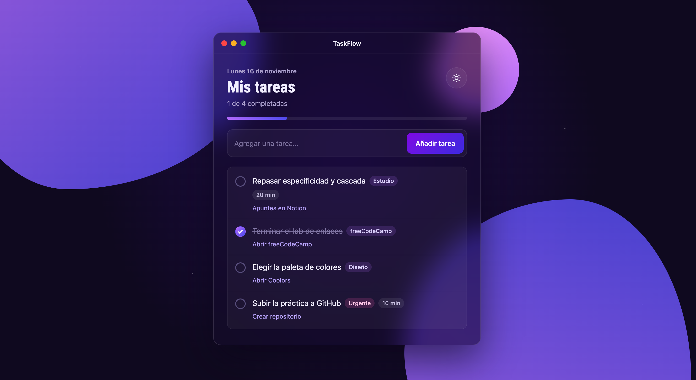
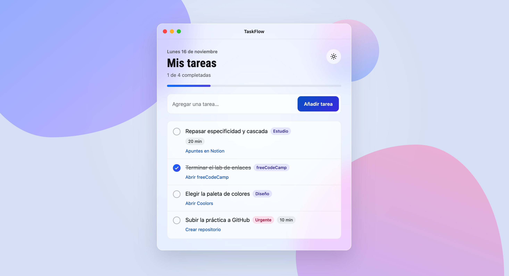
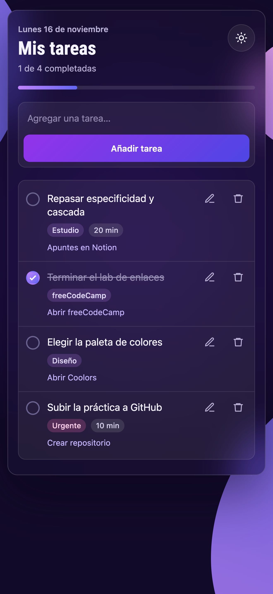
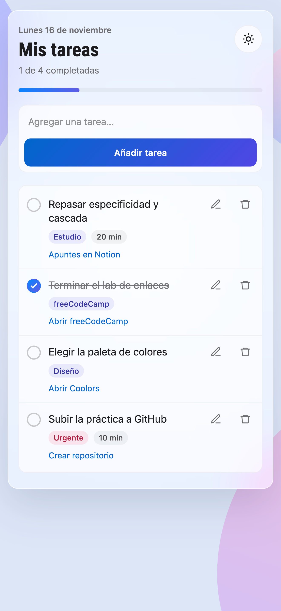

# TaskFlow

Lista de tareas con estética de vidrio esmerilado, modo claro y oscuro, y diseño adaptable a escritorio y celular.

**[Ver demo en vivo →](https://carlosluismolinaramirez.github.io/taskflow/)**



## Características

- Diseño con efecto vidrio (`backdrop-filter`) sobre un fondo de formas orgánicas hecho solo con CSS
- Checkboxes personalizados: la tarea se tacha al marcarla, sin JavaScript
- Etiquetas por tarea (categoría, tiempo estimado, urgencia)
- Diseño responsive: se adapta a pantallas de celular con media queries
- Estados de enlaces accesibles: hover, foco visible para navegación con teclado
- Colores organizados con variables CSS, preparados para dos temas

## Tecnologías

- HTML5 semántico
- CSS3: variables, Flexbox, media queries, `backdrop-filter`, gradientes
- Tipografía: Roboto Condensed (Google Fonts) para títulos y fuente del sistema para el texto

## Diseño

| | Oscuro | Claro |
|---|---|---|
| **Escritorio** |  |  |
| **Móvil** |  |  |

La paleta completa, la tipografía y las medidas están en la [ficha de diseño](design/ficha-de-diseno.png).

| Uso | Oscuro | Claro |
|---|---|---|
| Fondo | `#120A2A` | `#DCE6F7` |
| Texto principal | `#F5F3FF` | `#1D1D1F` |
| Texto secundario | `#B9B0D6` | `#6E6E73` |
| Acento 1 | `#C084FC` | `#0A84FF` |
| Acento 2 | `#6366F1` | `#5E5CE6` |

## Cómo verlo

Probalo directamente en el navegador: [carlosluismolinaramirez.github.io/taskflow](https://carlosluismolinaramirez.github.io/taskflow/)

O cloná el repositorio y abrí `index.html`:

```bash
git clone https://github.com/CarlosLuisMolinaRamirez/taskflow.git
```

## Estructura

```
taskflow/
├── index.html
├── styles.css
├── README.md
└── design/
```

## Roadmap

- [x] **v1.0** — Diseño completo con HTML y CSS
- [x] **v1.1** — Accesibilidad: contraste WCAG AA, links con ícono y aviso de pestaña nueva
- [ ] **v2.0** — Agregar, editar y eliminar tareas, barra de progreso y botón de tema claro u oscuro (JavaScript)
- [ ] **v3.0** — Guardar las tareas en el navegador con `localStorage`

## Autor

**Carlos Molina** · [GitHub](https://github.com/CarlosLuisMolinaRamirez) · [LinkedIn](https://www.linkedin.com/in/carlosluismolina/)